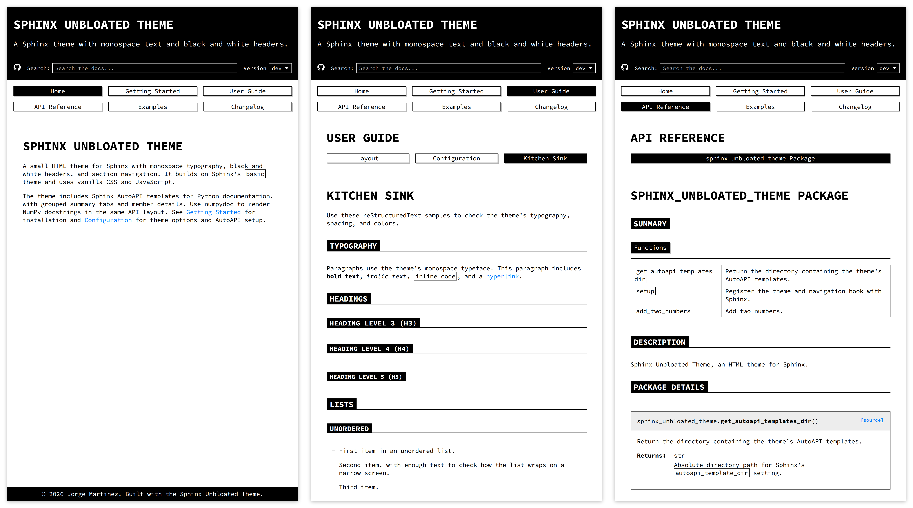

|python| |pypi| |GH-CI| |GPL|

.. |python| image:: https://img.shields.io/pypi/pyversions/sphinx-unbloated-theme?logo=python&logoColor=white&label=Python
   :target: https://pypi.org/project/sphinx-unbloated-theme/
   :alt: Python

.. |pypi| image:: https://img.shields.io/pypi/v/sphinx-unbloated-theme.svg?logo=pypi&logoColor=white&label=PyPI
   :target: https://pypi.org/project/sphinx-unbloated-theme/
   :alt: PyPI

.. |GH-CI| image:: https://github.com/jorgepiloto/unbloated/actions/workflows/pull-request.yml/badge.svg
   :target: https://github.com/jorgepiloto/unbloated/actions/workflows/pull-request.yml
   :alt: GH-CI

.. |GPL| image:: https://img.shields.io/badge/License-GPL--3.0-white.svg?labelColor=black
   :target: https://www.gnu.org/licenses/gpl-3.0.html
   :alt: GPL-3.0

About
=====

The Sphinx Unbloated Theme is an HTML theme for
`Sphinx <https://www.sphinx-doc.org/>`_. It inherits Sphinx's ``basic`` theme
and uses vanilla CSS and JavaScript. Sphinx is its only runtime dependency.

The theme bundles the Unbloated CSS library with Sphinx-specific layout styles,
Jinja2 templates, and configuration options. Colors, heading sizes, font stacks,
and shadow values come from the core library. Node.js is a contributor build
dependency, not a requirement for installing the Python package.

This adapter now lives in ``packages/sphinx`` of the Unbloated monorepo.
From that repository's root, run ``npm ci --ignore-scripts`` and
``npm run build:adapters`` before building Python distributions. Direct builds
fail when the generated core bundle is missing or differs from its provenance.
The monorepo's contribution guide documents package and artifact checks.

Screenshots
===========

Home page, user guide, and API reference, from left to right.

Installation
============

Use Python 3.12 or newer and Sphinx 9.0 or newer. The ``html`` and ``dirhtml``
builders are supported. The layout CSS uses native nesting, container queries,
and container units; use a browser supporting those features.

Quick install with pip:

.. code-block:: bash

   python -m pip install sphinx-unbloated-theme

Published releases can predate the monorepo source. To use this checkout,
prepare the adapter bundle and build a wheel from the monorepo root:

.. code-block:: bash

   npm ci --ignore-scripts
   npm run build:adapters
   python -m pip install build
   python -m build packages/sphinx
   python -m pip install packages/sphinx/dist/*.whl

Then set the theme in your ``conf.py``:

.. code-block:: python

   html_theme = "sphinx_unbloated_theme"

Documentation
=============

The checked-in documentation contains these sections:

- `Getting started`_. A brief overview of the theme, prerequisites, and
  installation instructions.

- `User guide`_. Detailed documentation of all configuration options,
  layout conventions, and CSS customisation hooks. This is the right place
  to learn how to tailor the theme to your project.

- `API reference`_. Auto-generated reference for the public Python API
  exposed by the theme package.

- `Examples`_. A gallery of self-contained scientific Python notebooks that
  demonstrate the theme rendering prose, code blocks, maths, figures, and
  interactive output.

- `Changelog`_. A version-by-version summary of notable changes, bug fixes,
  and new features.

Contributing
============

Read the `contribution guide`_ for setup, documentation builds, tests, and
changelog fragments. Contributions follow the `code of conduct`_. To report
a vulnerability, use the contact in the `security policy`_.

Development
===========

Use the monorepo's ``.github/workflows/pull-request.yml``, ``night.yml``, and
``release.yml``. Their adapter job stages bundles, builds and inspects
distributions, installs the Sphinx wheel, and runs theme regressions on Ubuntu
with Python 3.12. The job uploads artifacts; it does not publish this adapter
to PyPI. Root release publication targets the core npm package.

The ``doc-html`` tox environment builds this adapter's notebook documentation.
The root Hugo documentation is a separate site. See the `contribution guide`_
for working directories, dependencies, tests, and changelog fragments.

Source Map and API
==================

``src/sphinx_unbloated_theme/__init__.py``
    Registers the theme, core CSS, deferred browser scripts, and toctree-based
    navigation. ``get_autoapi_templates_dir()`` returns the installed AutoAPI
    template directory as a string without enabling the extension or writing
    files. ``setup(app)`` is Sphinx's registration entry point and returns
    version and parallel-safety metadata. Names beginning with ``_`` are
    internal navigation helpers.

``src/sphinx_unbloated_theme/theme/sphinx_unbloated_theme/``
    Holds Jinja templates, theme options, layout CSS, fonts, and notices.
    ``static/js/autoapi.js`` enhances direct summary panels into keyboard tabs;
    without scripts all groups remain visible. ``static/js/version-switcher.js``
    loads the configured version feed, uses literal labels, validates same-origin
    destinations, and hides the selector on invalid or failed feeds.

``hatch_build.py``
    Requires generated CSS, provenance, and license files before wheel or source
    builds. ``validate_core_bundle(root)`` checks the recorded digest without
    changing files. The root adapter checker additionally compares the bundle
    with the current core build.

``doc/source/conf.py``
    Configures AutoAPI and notebook documentation. It stages examples with
    exclusive file creation and tracks its copies for cleanup. After successful
    HTML or directory-HTML builds, it copies scripts and asks Quarto to render
    notebook PDFs. Failures and other builders skip exports; cleanup runs before
    exporters. Missing Quarto logs a warning and leaves PDF downloads unavailable;
    a failed Quarto render propagates an error.

``examples/``
    Scientific demonstrations executed by the documentation build. They use
    NumPy and Matplotlib and have top-level calculations, plots, and output.
    Importing them executes that work. Treat them as notebook sources rather
    than a validated numerical API.

``tests/``
    Python builder regressions and imported Playwright, Puppeteer, and Backstop
    suites. The root ``tests/adapter-browser`` suite exercises a small consumer
    with the real core bundle. The package-local npm build is legacy tooling
    that minifies authored CSS in place; monorepo staging does not need it.

Configuration Contract
======================

``project``, ``site_description``, and navigation labels are plain text escaped
by templates. ``footer_text`` accepts trusted HTML; do not pass untrusted text
as HTML. Configure optional social destinations and ``versions_url`` through
``html_theme_options``; omitted destinations are hidden. The `configuration
reference <doc/source/user-guide/configuration.rst>`_ lists all options.

Navigation follows Sphinx toctrees, including descendants outside a section's
directory. Set ``html_baseurl`` with the deployment prefix and add
``html_additional_pages = {"404": "404.html"}`` for the hosted error page.
Its issue link appears only for an HTTPS GitHub repository destination.

Prose links remain underlined. Header controls reflow at narrow widths, and the
version selector uses path-boundary matching with an explicit unmatched state.
AutoAPI print output includes all summary panels and their rubric headings
without changing screen selection. The monorepo's ``ROADMAP.md`` and
``anti-slop/`` reports record browser acceptance evidence and its limits.

Troubleshooting
===============

For troubleshooting or reporting issues, please open an issue in the project
repository:

- Go to the `project repository`_.
- Click the **Issues** tab.
- Click **New Issue**.
- Provide a clear description of the problem, including any error messages,
  code snippets, or screenshots that help reproduce it.

License
=======

Copyright (c) 2026 Jorge Martinez. This project uses the GNU General Public
License, version 3 only (``GPL-3.0-only``). See `LICENSE`_ for its terms.
The bundled AutoAPI templates include their Apache-2.0 license and attribution.
Source Code Pro fonts retain Adobe's copyright notice and SIL Open Font
License in ``_static/fonts/LICENSE.txt``. Inline icons adapted from Font
Awesome retain attribution comments and the license in
``_static/licenses/font-awesome-LICENSE.txt``. These files are included in
the package and copied into generated documentation.

Changelog
=========

The changelog tracks notable changes for each release of the Sphinx Unbloated
Theme. To view the full history, see the `changelog file`_ in the repository.

.. _getting started: doc/source/getting-started.rst
.. _user guide: doc/source/user-guide.rst
.. _api reference: doc/source/api-reference.rst
.. _examples: doc/source/examples.rst
.. _changelog: doc/source/changelog.rst

.. _project repository: https://github.com/jorgepiloto/unbloated
.. _contribution guide: https://github.com/jorgepiloto/unbloated/blob/main/packages/sphinx/CONTRIBUTING.md
.. _code of conduct: https://github.com/jorgepiloto/unbloated/blob/main/packages/sphinx/CODE_OF_CONDUCT.md
.. _security policy: https://github.com/jorgepiloto/unbloated/blob/main/packages/sphinx/SECURITY.md
.. _LICENSE: https://github.com/jorgepiloto/unbloated/blob/main/packages/sphinx/LICENSE
.. _changelog file: https://github.com/jorgepiloto/unbloated/blob/main/packages/sphinx/doc/source/changelog.rst
